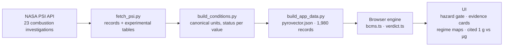

<h1 align="center">PyroVector</h1>

<p align="center"><strong>Turning 23 NASA microgravity combustion investigations into boundary-matched, DOI-verified fire safety envelopes for spacecraft habitat engineers.</strong></p>

<p align="center">
  
  
  
  
  
</p>

<p align="center">
  <strong>Live app:</strong> <em>link added at deployment</em> ·
  <a href="https://www.spaceappschallenge.org/2026/challenges/flame-in-freefall/">Challenge statement</a> ·
  <a href="#method">Method</a> ·
  <a href="#validation">Validation</a>
</p>


## The problem

The Moon Base and pressurised rovers are expected to run oxygen-enriched cabins, at about 30% O₂ and 10.2 psi or less, so that crews can suit up without long pre-breathing. In that atmosphere, materials are far more flammable than on Earth. NASA has flown decades of microgravity fire experiments, and the results are public in its Physical Sciences Informatics (PSI) repository. But they are hard to find, harder to compare, and harder still to read against a specific cabin design.

An engineer qualifying a cabin material needs to know three things:

1. Which NASA tests come closest to my atmosphere, my ventilation and my material?
2. Why do they match, and how closely?
3. Where does the evidence stop?

## What PyroVector does

Pick a mission atmosphere (ISS, lunar base or rover, exploration atmosphere, EVA suit) or set O₂, pressure and airflow. Then choose a material or fuel and a safety pillar: **Flammability** or **Suppression**.

| Feature | What the engineer sees |
| --- | --- |
| **Boundary Condition Match Score (BCMS)** | A deterministic 0–100 score of how closely each NASA record's *recorded* conditions match the target, broken into O₂, material, airflow, pressure and pillar/scale |
| **Evidence cards** | One best record per investigation. Each shows NASA's verbatim cell and column beside every converted value, the table and row, recorded outcomes, and a DOI link |
| **Extrapolation Hazard** | Raised when coverage is weak, when the best match was tested in a different oxygen class, or when Moon or Mars gravity is selected. It lists the nearest recorded NASA conditions with exact differences |
| **Regime maps** | Every relevant NASA record against the target crosshair. Flammability shows O₂ vs airflow; Suppression shows O₂ vs pressure, coloured by NASA's recorded outcome |
| **Cited 1 g vs µg evidence** | For materials NASA tested both ways (SAFFIRE-II), the records side by side, with no conclusion drawn when the hazard is active |
| **Shareable scenarios** | The URL encodes the whole scenario, so a colleague or judge opens the exact view in one click |


## How it works



- **Pipeline (Python).** Pulls every investigation and experimental table from NASA's public PSI API. It converts each condition to canonical units (O₂ % by volume, pressure in kPa, airflow in cm/s) through explicit, auditable column mappings. Every value gets a status: `recorded`, `approx`, `range`, `levels`, `footnote`, `not_recorded`, `unparsed` or `suspect`. See [docs/DATA.md](docs/DATA.md).
- **Engine (TypeScript, in the browser).** Pure functions score, rank, gate and assemble evidence. Ranking is instant, works offline once loaded, and never calls an AI model.
- **App (Next.js 16, deployed on Vercel).** A static page plus one JSON data bundle. No server, no keys, no tracking.

## Method

```text
BCMS = 100 × Σ (weight × sub-score), over the dimensions NASA recorded

O₂        30%   exp(−|ΔO₂| / 15)    Δ in % points
Material  25%   exact 1.0 · calibrated condensed-fuel surrogate 0.9 · same fuel phase 0.75 · other 0.4
Airflow   20%   exp(−|ΔV| / 15)     Δ in cm/s
Pressure  15%   exp(−|ΔP| / 50)     Δ in kPa
Pillar    10%   same pillar full-scale 1.0 · same pillar chamber 0.8 · other 0.3
```

**Extrapolation Hazard.** It is raised when any of these holds:

- The best match in the active pillar scores below 65%.
- The best match's O₂ differs from the target by more than **±2 % points**, or was not recorded.
- 0.16 g (Moon) or 0.38 g (Mars) is selected.

While it is active, no conclusion is drawn about the engineer's cabin.

### Design rationale (first principles)

- **Oxygen gets its own gate, not just a weight.** O₂ concentration is the primary driver of flammability. A strong match on material and airflow must not "cover" a different atmosphere. NASA's candidate atmospheres step 21 → 26.5 → 30 → 34 % O₂, and a ±2-point tolerance keeps the best match inside the engineer's atmosphere class. Without the gate, a SAFFIRE-II test at ~22% O₂ would score 72.7% for a 30% lunar cabin and pass silently.
- **Missing means zero, never a guess.** No solid-material flammability table in PSI (SAFFIRE, BASS, BASS-II) recorded cabin pressure. Those records score 0 on pressure and cap at 85%. Assuming 1 atm would inflate exactly the evidence engineers rely on most.
- **Ranges and levels are treated differently.** A range (`21.5–21.7`) matches anywhere inside it. Discrete levels (`21; 26.5; 40`) match only the listed values, never the span between them.
- **Plans are not results.** FLEX-2's planned test envelopes (O₂ 17–30%, 0.5–3 atm, 0.1–5 cm/s) would match almost any target, so they are shown as context and never ranked.
- **Partial pressure is context, not a score.** O₂ partial pressure (O₂% × P) is shown beside the controls and on each record. Lunar-base air (30% at 70 kPa) and sea-level air both sit near 21 kPa of O₂, yet the higher mole fraction is what makes materials more flammable. That is why the score and the gate use concentration.
- **Uncontrolled variables are disclosed, not hidden.** Thickness and flow direction strongly affect flame spread, but too few NASA records vary them to score them fairly. They are shown for comparison, and a card warns when NASA's flow direction differs from the one selected.

## Validation

| Check | Result |
| --- | --- |
| Automated tests (`npm test`) | 35 passing: scoring rules, missing-data handling, levels and ranges, the O₂ gate, verdict gating, explanation wording, URL round trips |
| Weight robustness (`npm run robustness`) | Each weight ×0.8 and ×1.2 (renormalised), 6 scenarios, 60 runs. Top match unchanged in **58/60**, top-3 order in 55/60, hazard decision in **60/60**. The two changes are a near-tie (ACME BRE 60.5% vs SAFFIRE-II 58.8%, Nomex at 34% O₂), both below the threshold either way |
| Type-check and lint | `tsc` and ESLint clean |
| Data integrity | No number is shown that is not either a NASA cell (verbatim, with its column) or a published formula result. Physically implausible source values (known table typos) are withheld and flagged |

**Acceptance scenarios** (checked in the running app):

| Scenario | Result |
| --- | --- |
| ISS, SIBAL, 20 cm/s, Flammability | SAFFIRE-I 84%, SAFFIRE-II 82.9%, no hazard |
| Lunar base, PMMA, 5 cm/s | Hazard: best flammability match 60.1% and O₂ 7.9 points away |
| Lunar base, silicone, 20 cm/s | Hazard from the O₂ gate, even though BCMS is 72.7% |
| Lunar base, heptane, 0 cm/s, Suppression | FLEX 77.7% (recorded at 30% O₂ and 71.3 kPa), no hazard; FLEX-2 not ranked |
| Any atmosphere at 0.16 g | Hazard; points to NASA's planned LUCI and FM2 partial-gravity experiments |

## Known limits

- PSI holds no partial-gravity combustion data. Microgravity and 1 g results bound, but do not establish, lunar or Martian behaviour.
- Solid-material tables do not record pressure. BASS-II logged airflow as fan settings rather than cm/s, so those records appear on the map's side strip, placed by O₂ only.
- Weights, scales, the 65% threshold and the ±2-point gate are documented design choices, not validated safety limits. BCMS measures how closely NASA's data covers a condition, **not fire safety**.
- The Detection pillar (SAME / SAME-R smoke data) is not yet scored.

## Run it

```bash
# Data pipeline (Python 3.10+): regenerates web/public/data/pyrovector.json
pip install -r requirements.txt
python scripts/fetch_psi.py
python scripts/build_conditions.py
python scripts/build_app_data.py

# Web app (Node 22+)
cd web
npm install
npm test               # 35 tests
npm run robustness     # weight-sensitivity check
npm run dev            # http://localhost:3000
```

## Repository layout

```text
scripts/            Python data pipeline (fetch → canonical conditions → app bundle)
data/               Processed NASA PSI data (raw API responses are regenerated, not committed)
web/src/lib/        Scoring engine, hazard gate, cited-evidence logic, URL state (pure TypeScript)
web/src/components/ UI: controls, hazard banner, headline, regime map, evidence cards, method panel
web/tests/          Node test-runner suites
web/scripts/        Robustness check
docs/               Data pipeline notes and screenshots
```

## Team and use of AI

**Prattay Banik**, solo team, Melbourne. Product owner and decision-maker:

- defined the problem, the target users, the ranking factors, the outputs and the scope
- made every design trade-off, each recorded with a timestamp in the project's decision log
- directed and approved the architecture and stack
- directed the AI coding assistants, reviewed their output, and tested the app

**AI assistance**, disclosed per NASA Space Apps rules. SI was not used to come up with the idea of how to solve the challenge.

- **Claude (Anthropic)** wrote most of the code: the data pipeline, scoring engine, UI and tests. It also proposed technical options and data-integrity corrections, each accepted or rejected by Pratt.
- **Codex (OpenAI)** independently reviewed the build plan and the app. It wrote the explanation-sentence and numeric-firewall hardening in `web/src/lib/explain.ts`, with its regression tests.
- Every AI-assisted source file carries an `SI-assisted` header comment.
- The Next.js scaffold came from `create-next-app` (not AI).
- **The live app runs no AI model.** Every ranking and number is computed deterministically from NASA's data.

## Data, references and licences

- **Data:** NASA Physical Sciences Informatics, https://psi.nasa.gov, CC0-1.0. All 23 investigations are cited in the app by DOI; see [docs/DATA.md](docs/DATA.md).
- **Challenge resources:** NASA Combustion Science; A Researcher's Guide to ISS Combustion Science; Apollo 1, Apollo 13 and Mir fire records; NASA spinoffs on firefighter air tanks, smoke detection and protective clothing.
- **Software:** Next.js and React (MIT), TypeScript (Apache-2.0), Tailwind CSS (MIT), ESLint (MIT), Python `requests` (Apache-2.0).
- **Licence:** PyroVector's original code is released under the [Apache License 2.0](LICENSE); see also [NOTICE](NOTICE).
- No NASA logos or branding are used. Use of NASA data does not imply NASA endorsement.
