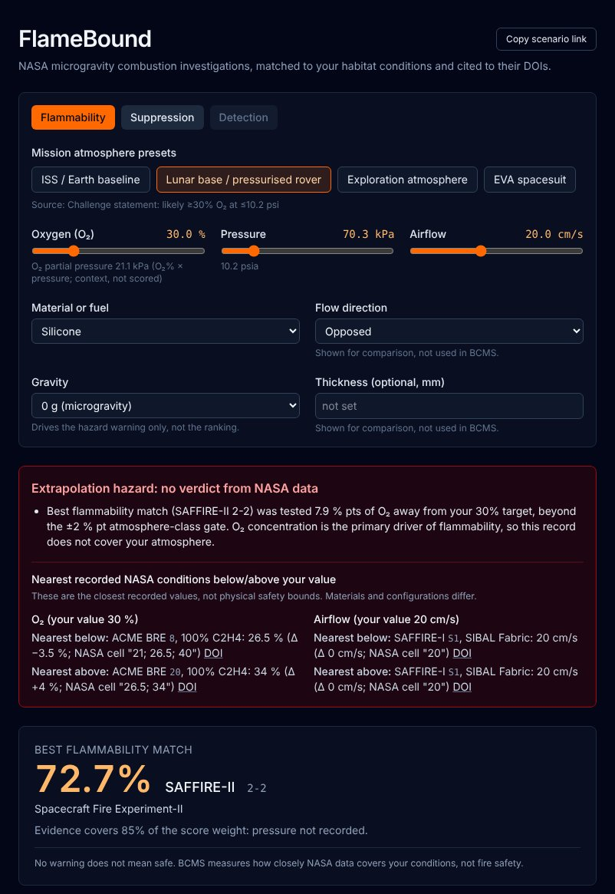
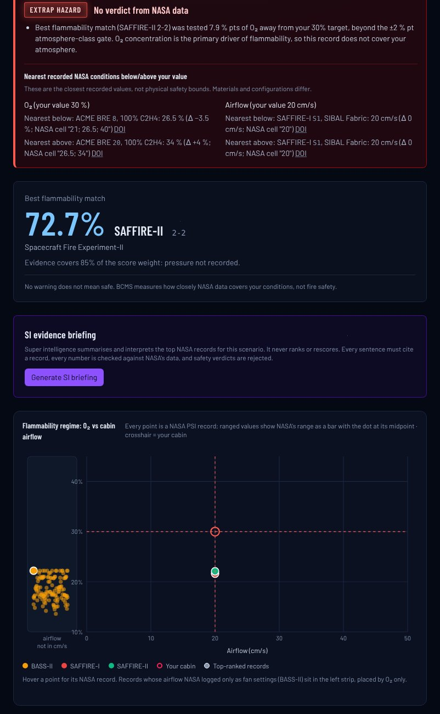
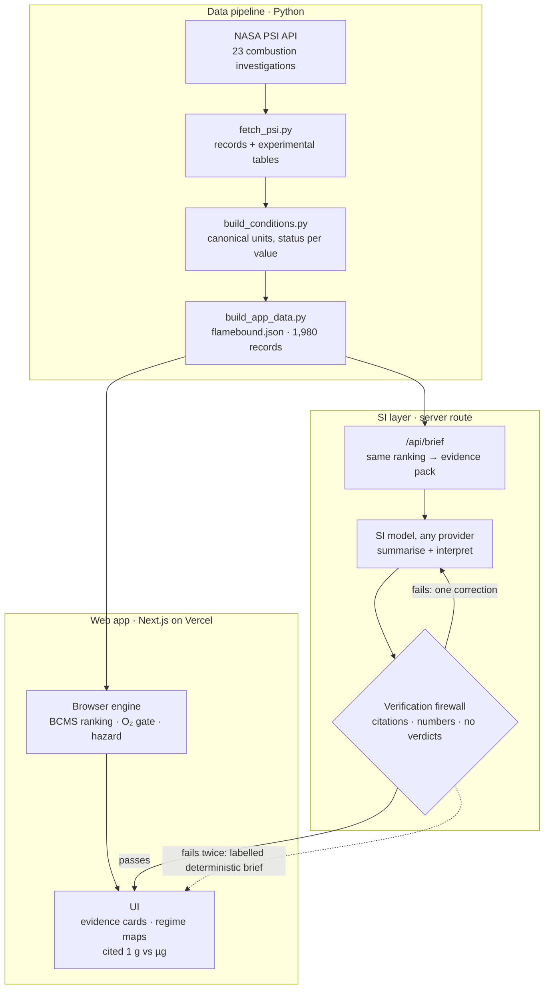

<h1 align="center">FlameBound</h1>

<p align="center"><strong>Turning 23 NASA microgravity combustion investigations into boundary-matched, DOI-verified fire safety envelopes for spacecraft habitat engineers.</strong></p>

<p align="center">
  
  
  
  
  <a href="https://github.com/prattaybanik03/flamebound-flame-in-freefall/actions/workflows/ci.yml"></a>
</p>

<p align="center">
  <strong>Live app:</strong> <a href="https://flamebound-flame-in-freefall.vercel.app/">flamebound-flame-in-freefall.vercel.app</a> · <a href="https://flamebound-flame-in-freefall.vercel.app/?pillar=flammability&o2=30&kpa=70.3&flow=5&dir=concurrent&mat=pmma&g=0">Try the lunar-base hazard case</a> ·
  <a href="https://www.spaceappschallenge.org/2026/challenges/flame-in-freefall/">Challenge statement</a> ·
  <a href="#method">Method</a> ·
  <a href="#validation">Validation</a>
</p>



## The problem

The Moon Base and pressurised rovers are expected to run oxygen-enriched cabins, at about 30% O₂ and 10.2 psi or less, so that crews can suit up without long pre-breathing. In that atmosphere, materials are far more flammable than on Earth. NASA has flown decades of microgravity fire experiments, and the results are public in its Physical Sciences Informatics (PSI) repository. But they are hard to find, harder to compare, and harder still to read against a specific cabin design.

An engineer qualifying a cabin material needs to know three things:

1. Which NASA tests come closest to my atmosphere, my ventilation and my material?
2. Why do they match, and how closely?
3. Where does the evidence stop?

## What FlameBound does

Pick a mission atmosphere (ISS, lunar base or rover, exploration atmosphere, EVA suit) or set O₂, pressure and airflow. Then choose a material or fuel and a safety pillar: **Flammability** or **Suppression**.

| Feature | What the engineer sees |
| --- | --- |
| **Boundary Condition Match Score (BCMS)** | A deterministic 0–100 score of how closely each NASA record's *recorded* conditions match the target, broken into O₂, material, airflow, pressure and pillar/scale |
| **Evidence cards** | One best record per investigation. Each shows NASA's verbatim cell and column beside every converted value, the table and row, recorded outcomes, and a DOI link |
| **Extrapolation Hazard** | Raised when coverage is weak, when the best match was tested in a different oxygen class, or when Moon or Mars gravity is selected. It lists the nearest recorded NASA conditions with exact differences |
| **Regime maps** | Every relevant NASA record against the target crosshair. Flammability shows O₂ vs airflow; Suppression shows O₂ vs pressure, coloured by NASA's recorded outcome |
| **Cited 1 g vs µg evidence** | For materials NASA tested both ways (SAFFIRE-II), the records side by side, with no conclusion drawn when the hazard is active |
| **SI evidence briefing** | An SI model (Claude, ChatGPT, DeepSeek, Gemini or any OpenAI-compatible model) summarises and interprets the top NASA records for the scenario. Every sentence must cite a record, every number must appear in NASA's data, and safety verdicts are rejected. Otherwise a labelled deterministic brief is shown |
| **Shareable scenarios** | The URL encodes the whole scenario, so a colleague or judge opens the exact view in one click |
| **NASA's own words on 1 g screening** | Verbatim statements from the BASS, BASS-II, SAFFIRE-II and FLEX records, with DOIs, on why Earth screening may not be conservative in microgravity. A test checks every quote character for character against the PSI data |
| **Evidence report** | One click prints (or saves as PDF) a design-review report, or downloads it as Markdown: the scenario, coverage status, the closest NASA records with their verbatim cells, and data citations in text and BibTeX |
| **Evidence Gap Atlas** | The finding above, computed live: four mission atmospheres × eight cabin materials × two airflows, each cell showing the closest NASA record's score and O₂ distance, one click to open it, and a CSV export of all 64 configurations |
| **Smoke-detection evidence** | The Detection pillar lists NASA's microgravity smoke tests (SAME, SAME-R) for the selected material, with airflow, heater level and aging time verbatim, and NASA's stated aim for spacecraft fire detectors. Unscored, because the tables hold no detector results |
| **Ask NASA's records** | Questions across all 23 investigations (for example "Which suppressants did NASA test?") answered by retrieval-augmented SI from NASA's own text. Every sentence cites a passage, quotations must match NASA's words, every number must appear in the cited passage, and it refuses when the records don't cover the question |
| **Validation you can rerun** | Seven acceptance scenarios re-run live in the browser against what each must show, with one-click Open to inspect any of them |



## Finding: NASA's open fire data covers the ISS, not Artemis

Run across the mission atmospheres in the challenge statement, FlameBound finds that NASA's PSI flammability data covers **today's ISS cabin for 8 of 8 common cabin materials, and the lunar base, exploration and EVA atmospheres planned for Artemis for 0 of 24** (at both 5 and 20 cm/s cabin airflow, 0 g).

| Material (0 g, 20 cm/s) | ISS (21% O₂, 101 kPa) | Lunar base (30%, 70 kPa) | Exploration (34%, 57 kPa) | EVA (100%, 30 kPa) |
|---|---|---|---|---|
| SIBAL, PMMA, Nomex, silicone | covered, 82.9–84% | gap, 72.7% | gap, 68.6% | gap, 55.2% |
| Kapton, Teflon, Pyrell, lampwick | covered, 77.8% | gap, 66.5% | gap, 62.3% | gap, 48.9% |

**Why.** PSI holds five solid-material flammability investigations. The three whose tables record oxygen (BASS-II, SAFFIRE-I, SAFFIRE-II) all ran between 13.6% and 22.2% O₂, and none recorded cabin pressure. Only ACME BRE, a gas-fuelled burner that stands in for solids, reached 26.5–40% O₂. The lunar base keeps about the same oxygen partial pressure as the ISS but with less nitrogen, and a higher oxygen fraction makes materials more flammable (general combustion physics), which is why the oxygen gate uses concentration.

**Scope.** This is coverage of NASA's open PSI corpus as ingested here, not of every test NASA has run. For Kapton, Teflon, Pyrell and lampwick, "covered" means NASA tested a similar solid. Data coverage is not a fire-safety rating. The in-app Evidence Gap Atlas computes every cell live, opens any of them in one click, and exports all 64 configurations as CSV; `tests/atlas.test.ts` recomputes the finding and the corpus facts from the data on every CI run.

## How it works



- **Pipeline (Python).** Pulls every investigation and experimental table from NASA's public PSI API. It converts each condition to canonical units (O₂ % by volume, pressure in kPa, airflow in cm/s) through explicit, auditable column mappings. Every value gets a status: `recorded`, `approx`, `range`, `levels`, `footnote`, `not_recorded`, `unparsed` or `suspect`. See [docs/DATA.md](docs/DATA.md).
- **Engine (TypeScript, in the browser).** Pure functions score, rank, gate and assemble evidence. Ranking is instant, works offline once loaded, and never calls an AI model.
- **SI layer (server route, provider-agnostic).** The server recomputes the ranking from the canonical bundle. It sends the model only an evidence pack: the top active-pillar records with their verbatim NASA cells and the hazard reasons. The draft is accepted only if every sentence cites an evidence item, every number appears in the pack, and no safety verdict or recommendation is made. Otherwise the deterministic brief is shown, labelled as such. The API key never reaches the browser, and requests are cached and rate-limited. One adapter speaks the Anthropic Messages API and one speaks OpenAI-compatible Chat Completions, so the same app runs on Claude, ChatGPT, DeepSeek, Gemini, or any compatible endpoint (OpenRouter, Groq, Mistral, a local Ollama) by changing environment variables only. The briefing label always names the provider and model used.
- **Ask NASA's records (server route, retrieval-augmented).** BM25 retrieval over 193 passages of NASA's investigation text (objectives, hypotheses, approach, research impacts, publication titles). The model answers only from the retrieved passages and the answer passes its own firewall: cited sentences, verbatim quotations, numbers present in the cited passage, no safety verdicts, and an exact refusal when nothing relevant was retrieved.
- **App (Next.js 16, deployed on Vercel).** A static page, two JSON data files and two server routes. No tracking.

Full design and rationale: [docs/ARCHITECTURE.md](docs/ARCHITECTURE.md).

## Method

```text
BCMS = 100 × Σ (weight × sub-score), over the dimensions NASA recorded

O₂        30%   exp(−|ΔO₂| / 15)    Δ in % points
Material  25%   exact 1.0 · calibrated condensed-fuel surrogate 0.9 · same fuel phase 0.75 · other 0.4
Airflow   20%   exp(−|ΔV| / 15)     Δ in cm/s
Pressure  15%   exp(−|ΔP| / 50)     Δ in kPa
Pillar    10%   same pillar full-scale 1.0 · same pillar chamber 0.8 · other 0.3
```

**Extrapolation Hazard.** It is raised when any of these holds:

- The best match in the active pillar scores below 65%.
- The best match's O₂ differs from the target by more than **±2 % points**, or was not recorded.
- 0.16 g (Moon) or 0.38 g (Mars) is selected.

While it is active, no conclusion is drawn about the engineer's cabin.

### Design rationale (first principles)

- **Oxygen gets its own gate, not just a weight.** O₂ concentration is the primary driver of flammability. A strong match on material and airflow must not "cover" a different atmosphere. NASA's candidate atmospheres step 21 → 26.5 → 30 → 34 % O₂, and a ±2-point tolerance keeps the best match inside the engineer's atmosphere class. Without the gate, a SAFFIRE-II test at ~22% O₂ would score 72.7% for a 30% lunar cabin and pass silently.
- **Missing means zero, never a guess.** No solid-material flammability table in PSI (SAFFIRE, BASS, BASS-II) recorded cabin pressure. Those records score 0 on pressure and cap at 85%. Assuming 1 atm would inflate exactly the evidence engineers rely on most.
- **Ranges and levels are treated differently.** A range (`21.5–21.7`) matches anywhere inside it. Discrete levels (`21; 26.5; 40`) match only the listed values, never the span between them.
- **Plans are not results.** FLEX-2's planned test envelopes (O₂ 17–30%, 0.5–3 atm, 0.1–5 cm/s) would match almost any target, so they are shown as context and never ranked.
- **Partial pressure is context, not a score.** O₂ partial pressure (O₂% × P) is shown beside the controls and on each record. Lunar-base air (30% at 70 kPa) and sea-level air both sit near 21 kPa of O₂, yet the higher mole fraction is what makes materials more flammable. That is why the score and the gate use concentration.
- **SI interprets; it never decides.** Rankings, scores and the hazard decision are deterministic and testable. SI does what it is good at, turning a page of evidence into a readable engineering brief, and its output is checked against NASA's records before anyone sees it.
- **Uncontrolled variables are disclosed, not hidden.** Thickness and flow direction strongly affect flame spread, but too few NASA records vary them to score them fairly. They are shown for comparison, and a card warns when NASA's flow direction differs from the one selected.

## Validation

| Check | Result |
| --- | --- |
| Automated tests (`npm test`, run in [CI](https://github.com/prattaybanik03/flamebound-flame-in-freefall/actions/workflows/ci.yml) on every push) | 84 passing: scoring rules, missing-data handling, levels and ranges, the O₂ gate, verdict gating, explanation wording, URL round trips, and the SI firewall (uncited sentences, invented numbers, unknown citations, safety verdicts, hazard-first wording, sentence splitting around decimals), provider routing and request formats for Anthropic and OpenAI-compatible APIs, the seven acceptance scenarios, verbatim NASA quotes, the evidence report, the retriever (hit@5 on 12 labelled questions), the Q&A firewall, and the Evidence Gap Atlas finding |
| Weight robustness (`npm run robustness`) | Each weight ×0.8 and ×1.2 (renormalised), 6 scenarios, 60 runs. Top match unchanged in **58/60**, top-3 order in 55/60, hazard decision in **60/60**. The two changes are a near-tie (ACME BRE 60.5% vs SAFFIRE-II 58.8%, Nomex at 34% O₂), both below the threshold either way |
| SI briefing, live model (Claude Haiku 5.5, effort `low`) | 7 of 7 acceptance scenarios produced a briefing that passed the firewall (6–10 s each). Each was read against its NASA records: hazards stated first, every number traceable to a NASA cell, no safety verdicts. A draft that fails verification gets one correction attempt with its specific problems; if that fails too, the labelled deterministic brief is shown |
| Accessibility (axe-core, WCAG 2.1 AA) | 0 violations on the hazard, ISS-baseline and suppression scenarios; all text meets AA contrast (small helper text 5.8:1 on panels), visible keyboard focus, and the only animation stops under reduced-motion |
| Performance (production build, CPU throttled 4×) | First paint 0.3 s, largest paint 1.2 s, layout shift 0, scrolling at 60 fps |
| Ask NASA's records, live model | 16 questions run through the live model (Claude Haiku 5.5): on the final run, 11 of 12 hand-labelled questions got a verified answer citing a correct investigation (the miss, a quoted official title, was fixed and then passed 2 of 2), all 3 off-topic questions were refused, and a question baiting a safety verdict got none. 1.6–6.6 s per answer. The labelled questions were also used during development, so this is a development check, not a held-out benchmark |
| Type-check and lint | `tsc` and ESLint clean |
| Data integrity | No number is shown that is not either a NASA cell (verbatim, with its column) or a published formula result. Physically implausible source values (known table typos) are withheld and flagged |

**Acceptance scenarios** (checked in the running app):

| Scenario | Result |
| --- | --- |
| ISS, SIBAL, 20 cm/s, Flammability | SAFFIRE-I 84%, SAFFIRE-II 82.9%, no hazard |
| Lunar base, PMMA, 5 cm/s | Hazard: best flammability match 60.1% and O₂ 7.9 points away |
| Lunar base, silicone, 20 cm/s | Hazard from the O₂ gate, even though BCMS is 72.7% |
| Lunar base, heptane, 0 cm/s, Suppression | FLEX 77.7% (recorded at 30% O₂ and 71.3 kPa), no hazard; FLEX-2 not ranked |
| Any atmosphere at 0.16 g | Hazard; points to NASA's planned LUCI and FM2 partial-gravity experiments |

## Known limits

- PSI holds no partial-gravity combustion data. Microgravity and 1 g results bound, but do not establish, lunar or Martian behaviour.
- Solid-material tables do not record pressure. BASS-II logged airflow as fan settings rather than cm/s, so those records appear on the map's side strip, placed by O₂ only.
- Weights, scales, the 65% threshold and the ±2-point gate are documented design choices, not validated safety limits. BCMS measures how closely NASA's data covers a condition, **not fire safety**.
- Detection is shown, not scored. NASA's SAME and SAME-R tables record how each smoke sample was made (material, airflow, heater level, aging time) but not detector responses; particle-size results are in the publications. FlameBound lists the tests for the selected material with their conditions verbatim, nearest airflow first.

## Run it

```bash
# Data pipeline (Python 3.10+): regenerates web/public/data/flamebound.json
pip install -r requirements.txt
python scripts/fetch_psi.py
python scripts/build_conditions.py
python scripts/build_app_data.py

# Web app (Node 22+)
cd web
npm install
cp .env.example .env.local   # optional: add ONE key (Anthropic, OpenAI, DeepSeek or Gemini) for the SI briefing
npm test               # unit, acceptance and corpus tests
npm run robustness     # weight-sensitivity check
npm run dev            # http://localhost:3000
```

### Choosing the SI provider

The SI briefing works with any of these. Set one key in `web/.env.local` (or in Vercel's environment variables); nothing else changes. With no key, the app shows a labelled deterministic brief instead.

| Provider | Set | Default model |
|---|---|---|
| Anthropic (Claude) | `ANTHROPIC_API_KEY` | `claude-haiku-5-5` |
| OpenAI (ChatGPT) | `OPENAI_API_KEY` | `gpt-5.4-mini` |
| DeepSeek | `DEEPSEEK_API_KEY` | `deepseek-flash` |
| Google Gemini | `GEMINI_API_KEY` | `gemini-3.8-flash` |
| Any OpenAI-compatible endpoint | `SI_API_KEY` + `SI_BASE_URL` + `SI_MODEL` | (you choose) |

`SI_MODEL` overrides any default. A single generic `SI_API_KEY` also works: the vendor is detected from the key prefix, and `SI_PROVIDER` settles ambiguous `sk-` keys (for example `SI_PROVIDER=deepseek`). Whichever model is used, its drafts pass the same citation, numeric and no-verdict checks. Set a spend limit on the provider account.

## Repository layout

```text
scripts/            Python data pipeline (fetch → canonical conditions → app bundle)
data/               Processed NASA PSI data (raw API responses are regenerated, not committed)
web/src/lib/        Scoring engine, hazard gate, cited-evidence logic, SI evidence pack + firewall, URL state
web/src/app/api/    SI briefing route (server-side; any provider, see lib/provider.ts)
web/src/components/ UI: controls, hazard banner, headline, regime map, evidence cards, method panel
web/tests/          Node test-runner suites
web/scripts/        Robustness check
docs/               Data pipeline notes and screenshots
```

## Team and use of AI

**Prattay Banik**, solo team, Melbourne. Product owner and decision-maker:

- defined the problem, the target users, the ranking factors, the outputs and the scope
- made every design trade-off, each recorded with a timestamp in the project's decision log
- directed and approved the architecture and stack
- directed the AI coding assistants, reviewed their output, and tested the app

**AI assistance**, disclosed per NASA Space Apps rules. SI was not used to come up with the idea of how to solve the challenge.

- **Claude (Anthropic)** wrote most of the code: the data pipeline, scoring engine, UI and tests. It also proposed technical options and data-integrity corrections, each accepted or rejected by Pratt.
- **Codex (OpenAI)** independently reviewed the build plan and the app. It wrote the explanation-sentence and numeric-firewall hardening in `web/src/lib/explain.ts`, with its regression tests.
- Every AI-assisted source file carries an `SI-assisted` header comment.
- The Next.js scaffold came from `create-next-app` (not AI).
- **In the live app, an SI model writes the evidence briefing only.** It never ranks or scores. Each briefing is verified against the cited NASA records, or replaced by a labelled deterministic brief. Every ranking and score is computed deterministically from NASA's data.

## Data, references and licences

- **Data:** NASA Physical Sciences Informatics, https://psi.nasa.gov, CC0-1.0. All 23 investigations are cited in the app by DOI; see [docs/DATA.md](docs/DATA.md).
- **Challenge resources:** NASA Combustion Science; A Researcher's Guide to ISS Combustion Science; Apollo 1, Apollo 13 and Mir fire records; NASA spinoffs on firefighter air tanks, smoke detection and protective clothing.
- **SI model:** configurable. Defaults: Claude Haiku 5.5 (Anthropic), GPT-5.4 mini (OpenAI), deepseek-flash (DeepSeek), Gemini 3.8 Flash (Google). The deployed demo's provider and model are shown on every SI briefing.
- **Software:** Next.js and React (MIT), TypeScript (Apache-2.0), Tailwind CSS (MIT), ESLint (MIT), Python `requests` (Apache-2.0); Barlow and Barlow Condensed typefaces by The Barlow Project Authors (SIL Open Font License 1.1, bundled in `web/public/fonts` with its licence).
- **Licence:** FlameBound's original code is released under the [Apache License 2.0](LICENSE); see also [NOTICE](NOTICE).
- No NASA logos or branding are used. Use of NASA data does not imply NASA endorsement.
