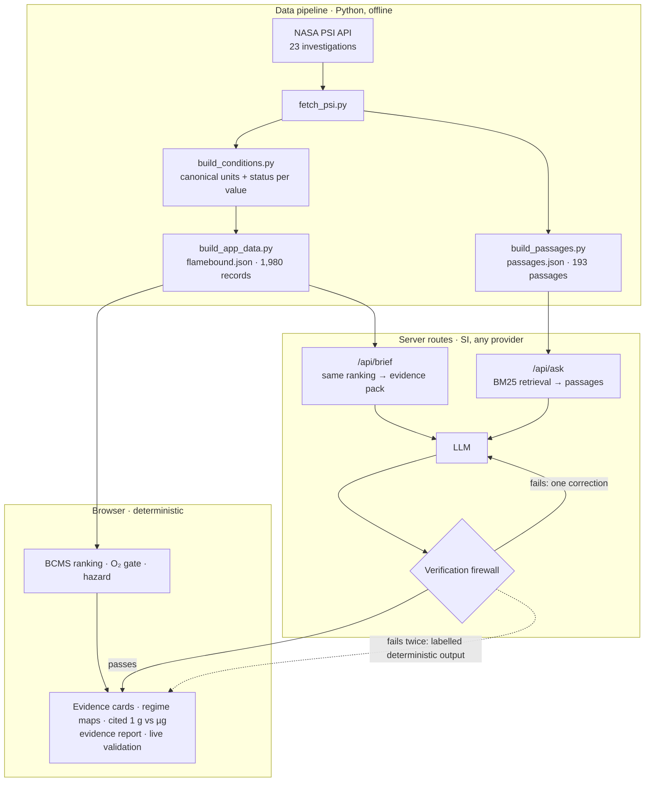

# FlameBound architecture

FlameBound answers one engineering question: *how closely does NASA's microgravity fire data cover my cabin, and where does it stop?* This document explains how it is built and why. The [README](../README.md) covers what it does and how it was validated.

## Design principles

1. **Deterministic where it matters.** Ranking, scores, the hazard decision and the evidence report are pure functions of NASA's data and the published formula. They never call a model, so the same inputs always give the same answer and every step is testable.
2. **SI interprets; it never decides.** Super intelligence summarises and explains evidence that the deterministic layer has already selected. Every SI output passes a verification firewall before anyone sees it, and a labelled deterministic alternative is always available.
3. **Missing means missing.** A condition NASA did not record scores zero. Nothing is imputed, and the coverage share is shown beside every score.
4. **Every number has an address.** Each value on screen is either a NASA cell (verbatim, with its column, table and row) or the result of a documented formula.

## System overview

## 1. Data pipeline

| Stage | Script | Output | Key decisions |
|---|---|---|---|
| Fetch | `scripts/fetch_psi.py` | Raw PSI metadata and experimental tables | Public PSI API, CC0 data; two non-combustion records excluded |
| Normalise | `scripts/build_conditions.py` | `data/conditions.csv` | Every condition converted to canonical units (O₂ % by volume, kPa, cm/s) through explicit column mappings. Each value carries a status: recorded, approx, range, levels, footnote, not_recorded, unparsed or suspect |
| Bundle | `scripts/build_app_data.py` | `web/public/data/flamebound.json` | One record per test row with the verbatim cell, its column and status kept beside every canonical value. Outcome fields copied verbatim per investigation |
| Corpus | `scripts/build_passages.py` | `web/public/data/passages.json` | Objective, hypothesis, approach, research impacts and publication titles, split into passages of at most about 650 characters at sentence boundaries. Text is verbatim; CI rebuilds it and fails on any difference |

Raw API responses are not committed; they are regenerated by `fetch_psi.py`. See [DATA.md](DATA.md).

## 2. Deterministic engine (`web/src/lib`)

**Boundary Condition Match Score (`bcms.ts`).** `BCMS = 100 × Σ (weight × sub-score)` over the dimensions NASA recorded. O₂ 30%, material 25%, airflow 20%, pressure 15%, pillar and scale 10%. Continuous conditions use `exp(−|Δ| / scale)` with scales of 15 % points, 15 cm/s and 50 kPa. Ranges match anywhere inside them; discrete levels match only the listed values. The best record per investigation is ranked.

**Why the weights and scales.** Oxygen concentration is the primary driver of flammability, so it carries the largest weight and, separately, a gate. Material comes next because flame spread differs strongly between materials. Airflow sets oxygen supply to the flame in the absence of buoyancy, so it outranks pressure for solids. The weights are documented design choices; `npm run robustness` perturbs each by ±20% and shows the top match unchanged in 58 of 60 runs and the hazard decision unchanged in 60 of 60.

**Extrapolation Hazard.** Raised when the best match in the active pillar scores below 65%, when its O₂ differs from the target by more than ±2 % points (or was not recorded), or when Moon or Mars gravity is selected. The O₂ gate exists because a strong match on material and airflow must not "cover" a different atmosphere class: without it, a SAFFIRE-II test at about 22% O₂ would score 72.7% for a 30% lunar cabin and pass silently.

**Cited verdicts only (`verdict.ts`).** A 1 g versus microgravity comparison is shown only from records where NASA tested both (SAFFIRE-II), and never while the hazard is active.

## 3. SI layer

Both SI features follow the same pattern: deterministic retrieval, generation by any configured provider, verification, one correction attempt with the specific problems, and a labelled deterministic fallback.

### Scenario briefing (`/api/brief`)
- **Retrieval is physical, not semantic.** The server re-runs the BCMS ranking for the scenario and builds an evidence pack: the top active-pillar records with their verbatim NASA cells and the hazard reasons. Embedding similarity would treat "30% O₂" and "22% O₂" as near neighbours; the physics-based retriever does not.
- **Firewall (`brief.ts`).** Every sentence cites an evidence item; every number appears in the pack; no safety verdict, certification or recommendation; if the hazard is active, the first sentence states the coverage gap.

### Ask NASA's records (`/api/ask`)
- **Retrieval (`retrieve.ts`).** BM25 over the 193 passages, with a small domain synonym list (for example suppressant → extinguishment). Deterministic and dependency-free. With 23 investigations the corpus would fit in a model's context, but retrieval keeps each request small, cheap and auditable: the answer can only cite what was retrieved.
- **Firewall (`qa.ts`).** Every sentence cites a retrieved passage; any quotation of four or more words must appear verbatim in the cited passage; every number must appear in the cited passage (gravity labels such as "1 g" and names such as "FLEX-2" excepted); no safety verdicts. The model must answer with one exact refusal sentence when no passage is relevant.

### Provider independence (`provider.ts`)
Two adapters cover almost every vendor: the Anthropic Messages API and OpenAI-compatible Chat Completions. The provider is selected by environment variables (vendor key, or a generic key with prefix detection and optional base URL and model). The deployed demo uses Claude Haiku 5.5 at low effort; every SI output is labelled with the provider and model that wrote it. Keys stay on the server; requests are cached and rate-limited per IP.

## 4. Evidence report (`report.ts`)
Markdown and print-ready HTML built from the same structured data: scenario, coverage status, the five closest records with their verbatim cells, and data citations in text and BibTeX. It contains no SI text, so it can go into a design review as a deterministic record.

## 5. Quality gates

| Gate | Where |
|---|---|
| Unit, acceptance and corpus tests (`node --test`) | `web/tests/`, run in CI on every push |
| Verbatim NASA quotes | `tests/findings.test.ts` checks every quoted statement character for character against the PSI records |
| Seven acceptance scenarios | `tests/validation.test.ts`, and re-run live in the browser in the Validation panel |
| Retrieval quality | `tests/retrieve.test.ts`: hit@5 on 12 hand-labelled questions (a development check: the same questions were used while tuning) |
| Weight robustness | `npm run robustness`, run in CI |
| Types and lint | `tsc --noEmit`, ESLint, in CI |
| Reproducible corpus | CI rebuilds `passages.json` and fails on any difference |
| Accessibility | axe-core, WCAG 2.1 AA, checked on the production build |
| Q&A with the live model | 16 questions run through the live model (Claude Haiku 5.5): on the final run, 11 of 12 hand-labelled questions got a verified answer citing a correct investigation (the miss, a quoted official title, was fixed and then passed 2 of 2), all 3 off-topic questions were refused, and a question baiting a safety verdict got none. 1.6–6.6 s per answer. The labelled questions were also used during development, so this is a development check, not a held-out benchmark |

## 6. Known limits
- PSI contains no partial-gravity combustion data; Moon and Mars scenarios always raise the hazard.
- Solid-material tables do not record pressure, so solids cap at 85% BCMS.
- Weights, scales, the 65% threshold and the ±2-point gate are design choices, not validated safety limits.
- Detection is shown, not scored: SAME and SAME-R tables record how smoke was made, not detector responses.
- The Q&A corpus covers NASA's summary text and publication titles, not the full papers.
